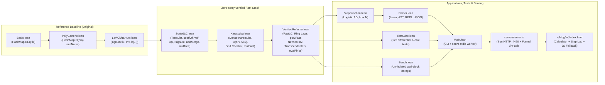

# Developer Guide: Building & Verifying `lean-inf` From Scratch

This guide walks through the entire architecture, mathematical rationale, proof techniques, and serving stack of `lean-inf` so you can rebuild any part of it by hand with full intuition.

---

## 1. System Overview & Module Map



---

## 2. Step-by-Step Build-It-Yourself Walkthrough

### Step 1: Catching Silent Bugs in the Original HashMap Code
Before optimizing anything, always audit the reference implementation—if the spec has a bug, a verified refactor will faithfully preserve that bug!

1. **The `Std.HashMap` `BEq` bug (`LeanInf/Basic.lean`, `LeanInf/PolyGeneric.lean`)**:
   - Original code: `xs.size == ys.size && xs.all (fun k v => ys.getD k v == v)`.
   - **Why it broke**: `getD k default` returns `default` when `k` is absent. Passing `v` as the default meant `ys.getD k v == v` evaluated to `v == v = true` for EVERY missing key! Thus `#{1 ↦ 5} == #{2 ↦ 7}` was `true`.
   - **Fix**: `ys.get? k == some v`.

2. **The `signum` sort-direction bug (`LeanInf/LeviCivitaNum.lean`)**:
   - Convention in `lean-inf`: positive exponents are powers of $H$, negative exponents are powers of $\varepsilon = H^{-1}$. So magnitude increases with exponent: $\varepsilon^2 < \varepsilon < 1 < H < H^2$.
   - Original `signum` sorted by `exp₁ < exp₂` (ascending!), so it inspected the *smallest infinitesimal* instead of the *dominant largest exponent*, reporting `signum(H - ε) = -1`!
   - **Fix**: sort descending `exp₁ > exp₂` in the legacy reference—and eliminate sorting altogether in `FastLC`.

3. **The non-pure `Inv` stub (`LeanInf/LeviCivitaNum.lean`)**:
   - Original `Inv.inv` returned `0` for any multi-term Levi-Civita number.
   - **Mathematical algorithm**: Every nonzero Levi-Civita number $x$ has a unique leading term $c_0 H^{e_0}$ ($c_0 \neq 0$). Factor it out:
     $$x = c_0 H^{e_0}(1 + \delta), \qquad \text{every exponent of } \delta \text{ is } < 0.$$
     Then $x^{-1} = c_0^{-1} H^{-e_0} (1 + \delta)^{-1}$, where $(1+\delta)^{-1} = \sum_{k=0}^\infty (-\delta)^k$ converges formally in the Levi-Civita valuation because each power $\delta^k$ shifts the maximum exponent strictly downward!

---

### Step 2: Designing `SortedLC` for Effortless Proofs (`LeanInf/SortedLC.lean`)

**Key design choice**: Separate *runtime representation* (`TermList := List (Rat × Rat)`) from *denotational semantics* (`coeffOf : TermList → Rat → Rat`):

```lean
def coeffOf : TermList → Rat → Rat
  | [], _ => 0
  | (e', c) :: rest, e => (if e' == e then c else 0) + coeffOf rest e
```

**Why this single definition unlocks the entire proof suite**:
- `coeffOf` works identically on *messy* lists (unsorted, duplicate exponents, zero entries—like raw Cartesian-product output `mulNaiveTerms`) AND on *canonical* lists (`WF`).
- You never have to normalize before stating a theorem! Equivalence is just:
  $$\forall e : \mathbb{Q},\quad \text{coeffOf}(\text{fast}) \; e = \text{coeffOf}(\text{naive}) \; e.$$

**Why `AllLt` + `WF` beats `List.Pairwise` for merge proofs**:
```lean
def AllLt (bound : Rat) : TermList → Prop
  | [] => True
  | (e, _) :: rest => e < bound ∧ AllLt bound rest

def WF : TermList → Prop
  | [] => True
  | (e, c) :: rest => c ≠ 0 ∧ AllLt e rest ∧ WF rest
```
With structural `AllLt`, proving `addMerge_wf` needs only `allLt_mono` and `addMerge_allLt`—no indexing, no `List.Pairwise` API wrangling. And `eq_of_wf_of_coeffOf_eq` (canonicality) falls out in ~30 lines by trichotomy on head exponents!

**Why `mulTree` uses balanced pairwise merging (`mergePairs` / `mergeAll`)**:
- Shifting sorted `ys` by a single term `(ex, cx)` takes $O(m)$ and preserves `WF` (`scaleTerm_wf`), giving $n$ already-sorted runs.
- A naive left fold `runs.foldl addMerge []` would cost $O(m + 2m + \dots + nm) = O(n^2 m)$.
- A balanced binary tree (`mergePairs` repeated $\lceil \log_2 n \rceil$ times) merges each level in $O(nm)$ total work, yielding $O(nm \log n)$ with zero hashing! Termination of `mergeAll` is a 10-line lemma `mergePairs_length_lt`.

---

### Step 3: Proving Karatsuba Multiplication with Zero `sorry` (`LeanInf/Karatsuba.lean`)

How do you apply Karatsuba (which expects dense integer-indexed polynomials $a_0 + a_1 u + \dots$) to a field with **arbitrary rational exponents**?

**Pattern: Untrusted Heuristic + Verified Linear Checker + Verified Fast Kernel + Verified Fallback**:
1. **Dense schoolbook spec (`dMulSchoolbook`)**:
   ```lean
   def dMulSchoolbook : List Rat → List Rat → List Rat
     | [], _ => []
     | c :: rest, b => dAdd (dScale c b) (0 :: dMulSchoolbook rest b)
   ```
   This 2-line definition makes bilinearity (`dCoeff_dMulSchoolbook_add_left/right`) and shift laws (`dCoeff_dMulSchoolbook_shift_left/right`) 5-line inductions!
2. **Dense Karatsuba (`dMulKaratsuba`)**:
   Split at `m = max a.length b.length / 2` (enforcing `cutoff ≥ 2` so `m ≥ 1` and all 3 recursive calls strictly shrink `max a.length b.length`):
   - `z0 = a0 * b0`
   - `z2 = a1 * b1`
   - `z1 = (a0 + a1) * (b0 + b1) - z0 - z2`
   - Result: `z0 + u^m z1 + u^{2m} z2`.
   In `dCoeff_dMulKaratsuba`, rewrite `a = a0 + u^m a1` and `b = b0 + u^m b1` via `dCoeff_take_add_drop`, expand both sides by bilinearity, and let Lean 4's `grind` discharge the ring cancellation `z1 = a0*b1 + a1*b0`!
3. **Division-free verified grid extractor (`extractGridAux`)**:
   Instead of dividing rational exponents by `step` (painful to prove!) to compute array indices, walk the descending `TermList` linearly with an explicit counter `idx : Nat` and `expected := e0 - idx * step`:
   - `e == expected`: emit `c`, advance `idx + 1` and `rest`.
   - `e < expected`: gap on the grid—emit `0`, advance `idx + 1`, keep `(e, c) :: rest`.
   - `e > expected` or `fuel == 0`: off-grid or too sparse—return `none` and fall back to `mulTree`!
   Soundness (`extractGridAux_sound`) is a 20-line induction on `fuel`.
4. **Top-level unification (`coeffOf_mulFast`)**:
   `guessGridStep` is completely untrusted—whatever positive `step` it proposes, if `extractGridAux` succeeds on both operands, `coeffOf_fromGrid_dMulKaratsuba` guarantees exact equivalence to `mulNaiveTerms`; otherwise `mulTree` guarantees exact equivalence!

---

### Step 4: Proof-Carrying `FastLC`, Binary Power, and Newton Inversion (`LeanInf/VerifiedRefactor.lean`)

1. **Zero-cost subtype `FastLC`**:
   ```lean
   structure FastLC where
     terms : TermList
     wf : TermList.WF terms
   ```
   Because `wf : Prop`, Lean erases it completely in compiled C code—you get type-level canonicality for free!
2. **Commutative ring laws via `@[ext]`**:
   Once `FastLC.ext` (`(∀ e, x.coeff e = y.coeff e) → x = y`) is registered, `add_comm`, `add_assoc`, `mul_comm`, `mul_assoc`, `mul_add` are each 2–5 lines!
3. **Binary exponentiation (`powFast_eq_powNaive`)**:
   Strong induction on `n`, using `powNaive_add` (`x^(a+b) = x^a * x^b`, which uses our verified `mul_assoc`!).
4. **Quadratic convergence of Newton-Raphson inversion**:
   - Step: `newtonStep u y := y * (2 - u * y)`.
   - Algebraic law (`newton_residual_squares`): `1 - u * newtonStep u y = (1 - u * y)²`.
   - Valuation law (`mul_allLe`): if `x` has all exponents `≤ a` and `y` has all exponents `≤ b`, then `x * y` has all exponents `≤ a + b`.
   - Combining the two (`newton_order_doubles`): if `1 - u * y` is $O(\varepsilon^d)$, then `1 - u * newtonStep u y` is $O(\varepsilon^{2d})$! So 5 iterations reach $2^5 = 32$ terms of accuracy instead of 32 multiplications.
5. **Overflow-proof `ratToFloat` (`evalFinite`)**:
   Summing dozens of exact rational Taylor terms produces numerators and denominators exceeding $2^{1024}$ ($\approx 10^{308}$), where `Float.ofNat num / Float.ofNat den` becomes `Inf / Inf = NaN`. Shifting both `num.natAbs` and `den` right by `max (log2 - 53) 0` and rescaling with `Float.scaleB mant (sa - sb)` preserves full 53-bit IEEE-754 precision for rationals of *any* size!

---

### Step 5: Step Function AD & Finite Evaluation (`LeanInf/StepFunction.lean`)

- **Function**: `logisticStep x := 1 / (1 + exp(-H * x))` when `-H * x` is finite, `1` when `-H * x` is negative infinite, `0` when positive infinite.
- **Why $\eta = \varepsilon^2$**: At $x = c\varepsilon$, $-H(x \pm \varepsilon^2) = -c \mp \varepsilon$. Because $\mp\varepsilon$ is infinitesimal, `expOrder` expands $e^{-c} \cdot e^{\mp\varepsilon}$ cleanly inside the Levi-Civita field!
- **Central difference**: `(L_H(x + ε²) - L_H(x - ε²)) / (2ε²)` cancels the $O(1)$ asymmetry and yields `(1/4)H - (1/48)ε + (1/480)ε³ - ...` at $x = 0$ with exact rational coefficients.
- **Relative finite specialization**: `evalFinite x N` replaces $H^q \mapsto N^q$ (so $\varepsilon^k \mapsto N^{-k}$ and probe point $x = c\varepsilon \mapsto c/N$). Every symbolic Levi-Civita result specializes cleanly to ordinary floating-point numbers for plotting!

---

### Step 6: Benchmarking Without Getting Fooled by the Compiler (`LeanInf/Bench.lean`)

Lean 4 performs aggressive **common subexpression elimination (CSE)** and **loop-invariant code motion (LICM)** on pure functions. If you write:
```lean
let ok := f a b == g a b
for _ in [:iters] do acc := acc + f a b
```
the compiler will reuse the already-computed `f a b` and report `0.1 µs` for a `27 ms` multiplication!
To measure real work:
1. Mark benchmark entry points `@[noinline]`.
2. Prebuild a pool of distinct inputs (`poolSize := 8`) and index by the loop counter `i % poolSize`.
3. Accumulate a data-dependent checksum and branch on it at the end so dead-code elimination cannot strip the work.
4. Cross-check scaling ratios across powers of two ($n = 8, 16, 32, 64, 128, 256, 512$): Naive scales $\sim 4.0\times$ per doubling ($O(n^2)$), Karatsuba scales $\sim 2.9\times$ ($O(n^{1.585})$).

---

### Step 7: Connecting Compiled Lean 4 to the Static Blog (`server/server.ts`, `~/blog/inf/index.html`)

1. **Persistent Lean worker (`inf serve-stdio`)**: Spawning a process per HTTP request adds ~25–50ms on macOS. Instead, `Main.lean` provides `serve-stdio`, reading one tab-delimited command per stdin line and flushing one JSON line per stdout response. Dispatch drops to **0.18 ms – 2.2 ms**!
2. **Bun HTTP bridge (`server/server.ts`, port `4420`)**: Zero npm dependencies, serializes requests through a promise queue into the persistent Lean worker, auto-restarts on unexpected exit, serves CORS headers for any blog origin, and runs persistently via `~/Library/LaunchAgents/com.alok.lean-inf.plist`.
3. **Tailscale Funnel subpath (`/inf-api`)**: `tailscale funnel --bg --set-path /inf-api http://127.0.0.1:4420` publishes the Lean 4 API at `https://mac.tailbf1ac1.ts.net/inf-api` on port 443 without disturbing `site-editor` on `/`.
4. **Resilient Static Blog UI (`~/blog/inf/index.html`)**: Probes local `127.0.0.1:4420` and `https://mac.tailbf1ac1.ts.net/inf-api` on load; if your Mac is awake, every expression evaluates in real verified Lean 4 with a live latency badge; if your Mac is asleep, it transparently falls back to a faithful client-side JS mirror so blog readers never hit a broken page.
